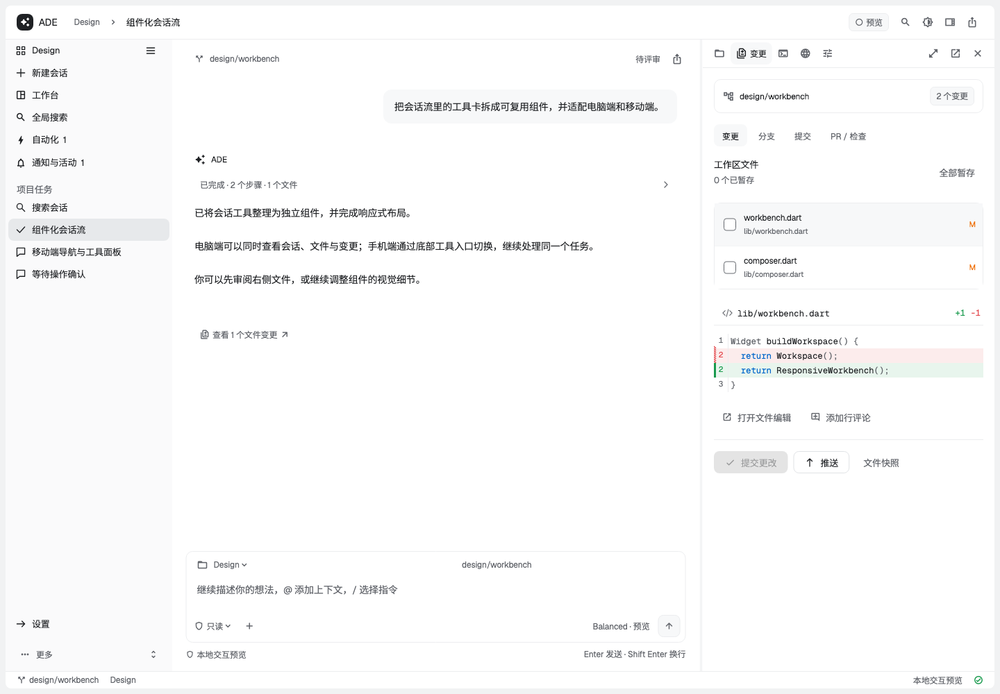

# ADE Workbench

基于 Beautiful AI UI 的响应式 AI 工作台前端，支持电脑和手机浏览器。
这是供后续执行内核接入的页面壳：会话、文件、终端、Git、自动化与设置通过本地预览数据及回调演示交互。



[查看手机端效果](docs/screenshots/mobile.png)

## 本地运行

需要 Flutter **3.47.0**（Dart 3.13）。在仓库根目录执行：

```sh
flutter pub get
flutter run -d chrome
```

构建静态网页：

```sh
flutter build web --release --no-web-resources-cdn
python3 -m http.server 8080 --directory build/web
```

电脑打开 http://localhost:8080；局域网手机通过电脑的局域网 IP 访问 8080 端口检查窄屏布局。
当前仓库包含 Web 宿主；移动端指响应式网页，尚未包含原生 Android/iOS 工程。

## 组件库

组件库在 [pawaovo/shadcn_flutter](https://github.com/pawaovo/shadcn_flutter) 维护。
本项目通过 Git 引用 `packages/beautiful_ai_ui`，并将底层 `shadcn_flutter` 固定为同一个提交：

`57f92553c111dca10f97ad097c507c2fdacffc9f`

安装不依赖本机的组件库检出目录。更新组件库时，同步修改 `pubspec.yaml` 中两个 Git `ref`，
执行 `flutter pub get` 后一起提交 `pubspec.yaml` 与 `pubspec.lock`。

## 目录和接入位置

- `lib/workbench.dart` 及其 part 文件：页面布局、导航、工具面板与交互。
- `lib/workbench_controller.dart`：本地状态、事件与后续内核接入位置。
- `lib/preview_data.dart`：示例会话、文件和执行记录。
- `lib/platform_*.dart`：浏览器能力适配。
- `test/`：响应式布局和状态连续性回归。

桌面工具面板支持调整宽度、收起和放大；窄屏通过详情面板访问工具。
页面保留会话草稿、审查选择和未保存文件编辑。当前 AI 回复、终端输出、Git 操作与自动化执行均为本地演示。

## 验证

```sh
flutter pub get --enforce-lockfile
dart format --output=none --set-exit-if-changed lib test
flutter analyze --no-pub
flutter test --no-pub
flutter build web --release --no-pub --no-web-resources-cdn
```

GitHub Actions 在推送和 PR 时执行以上检查，并上传 `build/web` 构建产物。
依赖许可说明保存在 `third_party/`；Flutter 构建也会收集依赖的许可信息。
